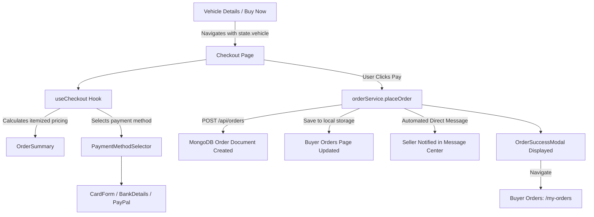

# Motors Payment Architecture & Developer Guide

## Overview
The `payment` folder manages vehicle checkouts, escrow reservations, payment method selection, pricing computations, and automated buyer-seller notifications.

---

## Directory Structure

```
src/components/payment/
├── index.js                      # Central barrel export
├── Checkout.jsx                  # Main coordinator page component
├── checkout.jsx                  # Re-export of Checkout for 100% backward compatibility
├── README.md                     # Architecture & developer guide
├── components/
│   ├── OrderSummary.jsx          # Vehicle snapshot preview, price breakdown, trust note
│   ├── PaymentMethodSelector.jsx # Method tabs (Credit/Debit Card, Bank Wire, PayPal)
│   ├── CardPaymentForm.jsx       # Card number with live spacing, MM/YY expiry, CVV & brand badges
│   ├── BankTransferDetails.jsx   # Escrow bank wire routing & reference code
│   ├── PayPalDetails.jsx         # PayPal Express button & purchase protection notice
│   ├── SecurityBadges.jsx        # 256-bit SSL, Escrow guarantee badges
│   └── OrderSuccessModal.jsx     # Post-purchase modal with order details & seller notification note
├── hooks/
│   └── useCheckout.js            # Custom hook encapsulating state, pricing, and submission
└── utils/
    ├── paymentCalculations.js    # Subtotal, tax rate (8.25%), processing fee, grand total math
    └── cardFormatters.js         # Card number spacing (4-4-4-4), expiry (MM/YY), card brand detection
```

---

## Data Flow & Order Lifecycle



---

## Key Features

1. **Automatic Buyer Order Page Addition**:
   - Every purchased vehicle is immediately stored via `orderService.placeOrder()` both in the MongoDB database and `localStorage` under `motors_orders`.
   - The Buyer's Orders page (`/my-orders`) automatically loads the newest order at the top with complete vehicle details (photo, title, VIN, price, order ID, and processing status).

2. **Automated Direct Message to Seller**:
   - Upon successful checkout, an automated direct message is generated:
     > *"🚗 Car Purchased! Buyer [Name] has completed checkout for your [Year Make Model] (Order #[orderId]) for $[Amount]. Payment Method: [Method]. Please review and prepare vehicle handover."*
   - This message is saved to the database (`/api/messages`) and local conversations (`motors_conversations`), immediately creating a live chat thread in the Seller's Message Center (`/seller-messages`).

3. **Modular & Testable**:
   - Form state and calculation logic live in pure utilities and `useCheckout`.
   - Clean subcomponents allow effortless extension with third-party SDKs (Stripe Elements, PayPal SDK, Paystack, Flutterwave).
